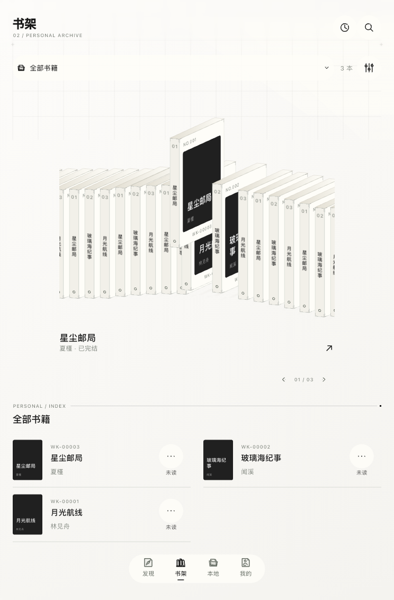

# 轻小说文库 · iOS / iPadOS 版


> 本仓库是非官方第三方移植，与原项目作者（Mikufoxxx、MewX）无隶属关系，不代表其立场。

基于 [mikufoxxx/Wenku8_Flutter](https://github.com/mikufoxxx/Wenku8_Flutter) v0.4.8 修改的第三方轻小说文库阅读器，只面向 iPhone 与 iPad。

本仓库与上游源码预览边界一致：只包含界面、阅读器、本地书库等本地实现，在线实现（文库账号、云书架、搜索、发现、书评、封面）不随源码发布；界面对应入口保留并显示“在线功能不可用”。本项目不运营在线书库，不自行发布小说资源，安装包不附带小说文件。小说、封面和插图的权利属于各自权利人；请勿绕过付费、版权或 DRM 限制。



*iPad mini 6 真机截图（0.4.8+192，界面布局沿用至 0.7.0）；书架为演示数据。*

## English summary

An unofficial iOS / iPadOS client for the Chinese light novel library Wenku8 (轻小说文库), forked from [mikufoxxx/Wenku8_Flutter](https://github.com/mikufoxxx/Wenku8_Flutter) v0.4.8 and maintained as a separate Flutter + Swift app. It supports TXT, EPUB, MOBI, AZW3 and more, with native iPad layout, system speech, Spotlight, Shortcuts and LAN reading sync. Licensed GPL-3.0-or-later; source-only, no App Store build.

## 与上游的差异

- 完整 iOS / iPadOS 适配：原生全屏、横竖屏、iPad 分栏与对页、系统语音听书、Spotlight、快捷指令、局域网续读；
- 不含在线实现：文库账号、云书架、搜索、发现、书评与在线封面不随源码发布，界面入口显示“在线功能不可用”；
- 本地文档导入：TXT、EPUB、MOBI、AZW、AZW3、PRC、DOC、DOCX、FB2、HTML、Markdown、RTF、PDF；
- 备份恢复、离线缓存；
- iOS 原生插件 12 个（会话、文档、PDFKit、系统语音、网络状态、局域网发现等）。

完整的改动清单、测试与验证状态见 [docs/CODE_ORIGIN.md](docs/CODE_ORIGIN.md)。

## 许可证

本仓库整体按 **GPL-3.0-or-later** 分发：上游为 GPL-2.0-or-later，本项目组合了 LGPLv3 组件，故整体升级为 GPL v3。`LICENSE` 为 GPL v3 全文；上游 GPL v2 原文保留在 `LICENSE-GPL-2.0.txt`；并保留 `NOTICE`、`docs/THIRD_PARTY.md`、`assets/licenses/GPL-3.0.txt`。

你可以自由使用、修改、再分发，前提是保留许可证、提供完整对应源码、不附加额外限制。修改后的版本继续按 GPL 分发。

本仓库某个 tag（如 `v0.7.0`）的源码，即该版本任何预编译分发的对应源码；如果你分发未签名 IPA，请同时提供该 tag 的完整源码（GPL-3.0 §6）。

## 隐私

应用不含遥测或第三方统计组件；检查更新会访问 GitHub Releases（上游仓库）或配置的镜像地址。本地导入的书籍不上传。

## 不提供的东西

- **App Store 版本**：GPL 与 FairPlay DRM、iOS 安装限制冲突，本项目不通过 App Store 分发；
- **Android / APK**：本项目只维护 iOS / iPadOS。仓库保留 `android/` 目录只为 Flutter 工程完整性，不提供安卓构建，也不再发布 APK；
- **预编译安装包**：仓库只提供源码。未签名 IPA 需自行构建。

## 构建

环境：macOS、Xcode 27.1、Flutter 3.41.5（Dart 3.11.3）、CocoaPods、iOS 15.0+。

```sh
flutter pub get
cd ios && pod install && cd ..
flutter build ios --release --no-codesign
```

在线实现不随本仓库发布，也不需要在构建时注入任何端点或密钥：构建产物的在线入口显示“在线功能不可用”，本地书库与阅读不受影响。

生成未签名 IPA：

```sh
cd build/ios/iphoneos
mkdir Payload
cp -R Runner.app Payload/
zip -r Wenku8-unsigned.ipa Payload
```

签名与安装：仓库**不绑定任何开发者 Team**。用 Xcode 打开 `ios/Runner.xcworkspace`，选择你自己的 Team，或用免费 Apple ID 自签安装。项目没有 App Group、推送、iCloud 等需要付费账号的能力。

## 测试

```sh
flutter analyze
flutter test            # 1153 通过，13 跳过（均为平台跳过）
```

以上数字为 2026-11-18 在 Flutter 3.41.5 / Dart 3.11.3 的实测结果，0 失败。

原生测试与真机验收记录见 [docs/INTERNAL_RECOVERY.md](docs/INTERNAL_RECOVERY.md) 第 15、18 节；验证边界也在那里如实列出。

## 反馈与讨论

- 使用问题、想法与新功能建议：[Discussions](https://github.com/accivlater/wenku8-ios/discussions)
- 确认是缺陷：[Issues](https://github.com/accivlater/wenku8-ios/issues/new/choose)
- 贡献代码前请读 [CONTRIBUTING.md](CONTRIBUTING.md)

## 文档

| 文件 | 内容 |
|---|---|
| [docs/CODE_ORIGIN.md](docs/CODE_ORIGIN.md) | 相对上游的改动、来源声明、验证状态 |
| [docs/INTERNAL_RECOVERY.md](docs/INTERNAL_RECOVERY.md) | 内部恢复手册：环境、构建、真机排错、归档 |
| [docs/RELEASING.md](docs/RELEASING.md) | 构建与分发说明 |
| [docs/THIRD_PARTY.md](docs/THIRD_PARTY.md) | 第三方组件与许可 |
| [docs/GITHUB_RELEASE.md](docs/GITHUB_RELEASE.md) | GitHub 仓库描述、Topics 与 Release 文案 |

## 致谢

- [mikufoxxx/Wenku8_Flutter](https://github.com/mikufoxxx/Wenku8_Flutter)：上游项目；
- [MewX/light-novel-library_Wenku8_Android](https://github.com/MewX/light-novel-library_Wenku8_Android)：Android 参照实现；
- 其余第三方组件见 `docs/THIRD_PARTY.md`。
